<picture>
  <source media="(prefers-color-scheme: dark)" srcset="./assets/header-dark.svg" />
  <source media="(prefers-color-scheme: light)" srcset="./assets/header-light.svg" />
  
</picture>

Rochester, NY &nbsp;·&nbsp; Open to internships and co-ops &nbsp;·&nbsp; [aryanpatill.github.io](https://aryanpatill.github.io)

 

### Selected work

**[f1-stream](https://github.com/AryanPatill/f1-stream)** 
Event-time stream processor for out-of-order F1 telemetry. 1,000 of 1,000 windows correct against ground truth, versus 979 for arrival-order processing. 
Python &nbsp;·&nbsp; asyncio &nbsp;·&nbsp; PostgreSQL &nbsp;·&nbsp; FastAPI

**[ai-entry-level-jobs](https://github.com/AryanPatill/ai-entry-level-jobs)** 
Preregistered study of whether AI is reducing entry-level employment. The research design was committed before any data was downloaded. 
Python &nbsp;·&nbsp; IPUMS CPS &nbsp;·&nbsp; Poisson fixed effects

**[The-Quants-Cockpit](https://github.com/AryanPatill/The-Quants-Cockpit)** 
Portfolio optimizer with incremental market-data ETL into SQL, Markowitz max-Sharpe allocation, and Monte Carlo stress tests. 
Python &nbsp;·&nbsp; SQLAlchemy &nbsp;·&nbsp; SciPy &nbsp;·&nbsp; Streamlit

**[credit_risk_dashboard](https://github.com/AryanPatill/credit_risk_dashboard)** 
Loan default risk scoring with single-applicant and portfolio views. 
Python &nbsp;·&nbsp; XGBoost &nbsp;·&nbsp; Streamlit &nbsp;·&nbsp; Plotly

 

### Stack

Python &nbsp;·&nbsp; SQL &nbsp;·&nbsp; PostgreSQL &nbsp;·&nbsp; FastAPI &nbsp;·&nbsp; asyncio &nbsp;·&nbsp; pandas &nbsp;·&nbsp; scikit-learn &nbsp;·&nbsp; XGBoost &nbsp;·&nbsp; SciPy &nbsp;·&nbsp; Streamlit

 

### Contact

[LinkedIn](https://www.linkedin.com/in/aryanpatil18/) &nbsp;·&nbsp; [Email](mailto:aryannpatill18@gmail.com) &nbsp;·&nbsp; [Portfolio](https://aryanpatill.github.io)
